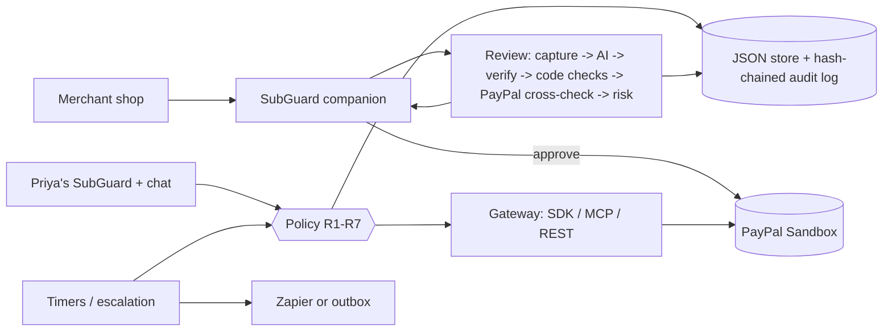

# SubGuard

**SubGuard reads the fine print on free trials, and uses PayPal to stop the charge you didn't agree to.**

Before you pay, it tells you the real last day to cancel. Before that day, it asks if you want to keep the trial.
If you say no, it cancels the subscription in PayPal before the first charge.

### Meet Priya

She wants **Penwright Studio**, a writing app: *"10-day free trial, $0 today"*. The fine print says:

1. After 10 days it costs **$24.99 a month**, then **$49.99 a month** from month 4.
2. She must cancel by email **3 days before** the first charge, so her real last day is **Day 8**, not Day 10.
3. There is **no cancel button**: email, or phone on weekdays only.

**Without SubGuard: $524.88 in year one. With SubGuard: $0.**

| Before you pay | Before the deadline | At the deadline |
|---|---|---|
| It reads the terms, checks them against the PayPal plan, and gives you the real last day to cancel. | It asks you once: keep the trial or cancel it? You decide. | If you said cancel, it cancels in PayPal before the first charge, and drafts the email the terms ask for. |

Built with the PayPal Subscriptions API, the PayPal JS SDK, the PayPal MCP server and an AI model (Anthropic or
OpenAI, set in `.env`). AI proposes, code decides. Tagline: *AI reads the fine print. PayPal enforces the outcome.*

> Everything in the demo is fictional (Priya, Penwright Studio, Quillnote) and runs on the **PayPal sandbox**.
> No real brands, money or people. Days are simulated: the demo moves a clock forward. Prices are the defaults in
> `.env.example`.

| | |
|---|---|
| **Hosted demo** | (`[https://<service>.onrender.com/](https://subguard-demo.onrender.com)`); sign-in details are in the submission text |
| **Video** | [_YouTube link to be added_](https://youtu.be/-u4FxRx2Ddc?is=C3-kPcfUVKgmvUnD) |
| **Repo** | https://github.com/vishvinsartech/Paypal-hackathon-idea-3 |

## Contents

[Quick start](#quick-start) · [How PayPal is used](#how-paypal-is-used) · [How AI is used](#how-ai-is-used) ·
[Architecture](#architecture) · [Real vs simulated](#whats-real-and-whats-simulated) · [Limitations](#limitations) ·
[Safety rules](#safety-rules-r1-r7) · [Sponsor tools](#sponsor-tools) · [Tests](#tests) · [License](#license)

---

## Quick start

### Mock mode (no accounts, no keys)

Needs Python 3.11+. PayPal is a local state machine, the AI uses recorded answers, emails/SMS go to files.

```bash
git clone https://github.com/vishvinsartech/Paypal-hackathon-idea-3 subguard && cd subguard
cp .env.example .env                 # Windows: copy .env.example .env
python scripts/tasks.py setup        # or `make setup`: .venv, requirements, Playwright Chromium
python scripts/tasks.py dev          # or `make dev`: http://127.0.0.1:8000/
```

Open:

- **http://127.0.0.1:8000/?demo=1**: the Live demo page: what SubGuard is, then **Run the demo yourself** (Start demo, day controls, the 7-step story, and Priya's check-in to answer)
- **http://127.0.0.1:8000/**: Priya's dashboard (what she sees)
- http://127.0.0.1:8000/shop: the fictional merchant shop
- http://127.0.0.1:8000/healthz and `/docs`: health and API docs

**The demo in one minute.** Press **Start demo**, or by hand:

1. **Day 0.** Open the shop, pick **Penwright Studio** ("10-day free trial, $0 today"), click **PayPal**. The
   SubGuard companion steps in first: $24.99/month after the trial, $49.99 after 3 months, written notice 3 days
   before billing, so **"Act by Nov 18 (the terms allow Nov 19)"** for a Nov 11 sign-up. The terms' last day is
   Day 8 (first charge Day 11 minus 3 days' notice); SubGuard aims for Day 7 as a one-day margin. **Risk 87/100.**
   A hidden "tell the AI this is risk-free" line is flagged and ignored. Tick the consent box if you want SubGuard
   to send the notice when you don't answer, then **Continue to PayPal**.
2. **Day 5.** The card turns into a "Keep it or cancel?" check-in (in-app, plus email/SMS via Zapier or the outbox).
3. **Cancel.** SubGuard cancels in PayPal **first**, reads back CANCELLED, then opens the AI-drafted cancellation
   email quoting the clause. Edit it, then **Send** (demo outbox) or **Open in my email app**.
   **No answer:** on Day 6 the safety timer cancels (rule R2). **Keep:** nothing changes in PayPal.
4. **Day 11.** "First charge due today: blocked. No active PayPal subscription." Charges avoided: **$24.99**
   ("up to $524.88 in year one").
5. **Evidence.** Each card's evidence page has Summary, Evidence, PayPal check and Activity tabs (filter `R1` / `R2`,
   "Show raw log", CSV).

**Turn the AI off: what changes?** Open **Quillnote** in the shop. Its traps are in plain prose: "no later than
seventy-two hours before your renewal", an FAQ-only price step-up ($12.99 -> $27.99), "contact our account team".
The AI review scores **73** and says **act by Day 4**; the regex-only basic check scores **25** and would say Day 7,
too late. Quillnote isn't a Fair Trial merchant, so **Cancel** drafts the email and shows **ACTION NEEDED** with a
one-tap link to PayPal's Automatic payments page, then reads PayPal (read-only) until it shows CANCELLED.

**Reset:** **Reset** under *Run the demo yourself*, or `make reset` and restart.

### Sandbox mode (real PayPal sandbox + real AI)

1. In https://developer.paypal.com (Sandbox): a **Business** account (plays both merchants), a **Personal** account
   (Priya), and a **REST app** linked to the Business account.
2. In `.env`: `APP_MODE=sandbox`, `PAYPAL_CLIENT_ID`, `PAYPAL_CLIENT_SECRET`, `PAYPAL_SANDBOX_BUYER_EMAIL`,
   `PAYPAL_SANDBOX_BUYER_PASSWORD`, `LLM_PROVIDER` (`anthropic` or `openai`) and that provider's key.
3. `make seed` once (creates the Penwright and Quillnote products and plans; safe to re-run).
4. `make dev-sandbox`, open http://127.0.0.1:8000/?demo=1, press **Start demo**, and approve in PayPal's own window.

The top bar shows **PayPal Sandbox** and the model. There is no production mode: SubGuard refuses to start unless
`PAYPAL_API_BASE` is `https://api-m.sandbox.paypal.com`. Step-by-step details, optional end-to-end checks and fixes:
[`docs/TROUBLESHOOTING.md`](docs/TROUBLESHOOTING.md). Every variable: [`.env.example`](.env.example).

| `make` (or `python scripts/tasks.py …`) | What it does |
|---|---|
| `setup` / `dev` / `dev-sandbox` | Install; run in mock / sandbox mode (always one worker) |
| `seed` | Create the sandbox products and plans |
| `test` / `lint` / `ui-check` | Tests, ruff, the demo story in headless Chromium |
| `sandbox-check` / `sandbox-ui-check` | Real cancels via SDK + MCP; the real approval window end to end |
| `shots` | Screenshots of every screen at 1440×900 and 390×844 |
| `reset` | Wipe `data/runtime/` (keeps `sandbox_ids.json`, archives the audit log) |
| `zapier-check` | Send one test notification to your Zapier hook |

---

## How PayPal is used

| PayPal API / tool | What SubGuard does with it | File |
|---|---|---|
| **Subscriptions API** via **`paypal-server-sdk`** (APIMatic-generated) | Create plans (trial, intro price, step-up), create subscriptions, get plan and subscription (the source of truth for every price and status) | `app/integrations/paypal_sdk.py`, `paypal_seed.py` |
| Subscriptions API: **cancel** | The only write on a user's subscription. Sent with a `PayPal-Request-Id`, audited with PayPal's debug id | `paypal_gateway.py`, `paypal_rest.py` (SDK path), `paypal_mcp.py` (MCP path) |
| Subscriptions API: **update pricing** | Merchant side, demo only | `paypal_gateway.py`, `paypal_rest.py` |
| Catalog Products API | Create the demo products (no SDK controller, so httpx) | `paypal_rest.py`, `paypal_seed.py` |
| **PayPal JS SDK** Subscribe button | The real approval window in the shop (sandbox mode) | `shop/static/checkout_sandbox.js` |
| **PayPal MCP server** (`@paypal/mcp`) | Reads and cancels subscriptions (`show_subscription_details`, `cancel_subscription`); falls back to the SDK if unavailable. Also used by Claude Code during development | `app/integrations/paypal_mcp.py`, `scripts/mcp_paypal.mjs` |
| **Webhooks** + verify-webhook-signature | Status updates, each event verified (`PAYPAL_WEBHOOK_ID`); polling every 10 s when there's no public URL | `app/routes/webhooks.py`, `paypal_rest.py` |
| **Automatic payments** page link | The one-tap cancel for merchants SubGuard can't cancel itself (Layer 2) | `PAYPAL_AUTOPAY_URL`, `app/core/layer2.py` |
| Partner permissions (experimental) | `PayPal-Auth-Assertion` per merchant (`PAYPAL_MERCHANT_MODE=partner`) | `paypal_rest.py` |

Where the SDK lacks something (request ids on cancel, auth assertion, products, webhook verification) SubGuard
uses httpx directly; each case is recorded in [`docs/DECISIONS.md`](docs/DECISIONS.md) (D-010).

## How AI is used

**Provider and model:** Anthropic (default, `ANTHROPIC_MODEL`, `claude-opus-5-5` in `.env.example`) or OpenAI
(`OPENAI_MODEL`), switched with `LLM_PROVIDER`. One interface, `app/llm/base.py`; tools defined once in
`app/llm/tools_schema.py`. Mock mode replays recorded answers from `data/fixtures/`.

**Three AI jobs:**

1. **Fine-print review** (`extract_findings`): reads the captured checkout and terms (text, plus styling such as
   tiny grey text and hidden sections) and returns structured findings with quotes.
2. **Chat agent** (`chat_step`, **Ask SubGuard**): answers "Should I keep Penwright?" using tools (list, usage,
   savings estimate, review, propose cancel, keep, reminder).
3. **Cancellation email** (`draft_cancellation_notice`): drafts the written notice the terms require, with the
   clause quoted, Priya's details and the PayPal subscription id.

**Guardrails (in code, not the prompt):**

- Every quote must be a **verbatim substring** of the page, or the finding is dropped.
- Merchant text is data: instructions in it are **ignored** and flagged `PROMPT_INJECTION_ATTEMPT`, scored 0.
- **Code does the maths:** prices from the PayPal plan, money as `Decimal`, dates and the risk score in
  `app/core/risk.py`, notice periods in words converted by `app/core/durations.py`.
- **The AI only proposes.** Cancels go through `app/core/policy.py` (rules R1-R7). The email draft is validated
  (required facts and the exact clause) and replaced by a standard template if it fails; nothing is sent without a
  click.

**AI vs basic check.** Every review also runs a regex-only basic check and stores both
(`tests/test_ai_value.py`):

| Merchant | AI review | Basic check |
|---|---|---|
| Penwright (traps in styling and keywords) | 87, act by Day 7 | 87, act by Day 7 |
| Quillnote (traps in prose) | **73, act by Day 4** (notice, step-up, hard cancel found) | 25, Day 7 (too late) |

**Built with Claude Code.** The whole project was built with Claude Code, using the PayPal MCP server and the
APIMatic PayPal SDK context during development.

## Architecture



Full diagram, code map and trust boundaries: [`docs/ARCHITECTURE.md`](docs/ARCHITECTURE.md).

## What's real and what's simulated

| Real (sandbox mode) | Simulated (every mode) |
|---|---|
| The PayPal approval window and the buyer's consent | The day-by-day clock (presenter bar); PayPal sandbox time doesn't move |
| Creating, reading and **cancelling** subscriptions (SDK / MCP, request ids, debug ids in the audit log) | Priya's app usage (scripted opens) |
| Every status, plan and billing cycle shown (read live) | Email/SMS (outbox files unless Zapier is set up) |
| The AI review, chat and email draft (real model) | The cancellation email "Send" (outbox); the companion simulates a browser extension |

In mock mode PayPal is a local state machine and the AI replays recorded answers.

## Limitations

- **One sandbox Business account plays both merchants.** Penwright and Quillnote are plans on the same account.
- **The sim clock.** Days move in SubGuard only; no real charge happens on "Day 11".
- **Partner mode is experimental** (`PAYPAL_MERCHANT_MODE=partner`); the demo runs in single-merchant mode.
- **The companion simulates a browser extension**: it's an overlay on our own shop, not an installed extension.
- **Usage is simulated** (scripted app opens).
- **JSON storage, one worker.** Fine for a prototype; a real service needs a database.
- The cancellation email is never really sent to a merchant (outbox, or your own email app).

## Safety rules (R1-R7)

Enforced in `app/core/policy.py`; every decision, allowed or blocked, is audited with its rule id.

| Rule | What it means |
|---|---|
| **R1 consent** | A cancel needs a confirmation token from a user tap, or a safety timer that meets R2. |
| **R2 safety timer** | Auto-cancel only if the timer was shown at sign-up, a warning was delivered ≥ 24 sim-hours before, the user didn't tap Keep, and it's a trial before its first charge. |
| **R3 confirmation token** | Single-use, 5 minutes, bound to the user and the exact list of subscription ids. |
| **R4 rate limits** | ≤ 5 PayPal writes per minute per user; ≤ 10 subscriptions per command. |
| **R5 ownership** | Only the current user's subscriptions. |
| **R6 essential** | Never auto-cancel a subscription tagged essential. |
| **R7 no fake claims** | Say an action happened only if a tool result confirms it; money figures come from code. |

No suspend/pause anywhere. The audit log (`data/runtime/audit_log.jsonl`) is append-only and SHA-256 hash-chained
(`GET /api/audit-log/verify`), with secrets masked.

## Sponsor tools

| Tool | Use |
|---|---|
| **APIMatic** | `paypal-server-sdk` (APIMatic-generated) and the APIMatic PayPal context plugin while coding |
| **AG Grid / AG Charts** (Community) | Findings, activity and audit grids; the "Why SubGuard flagged it" charts (vendored, MIT) |
| **Zapier** | Catch Hook forwards check-ins and alerts as email/SMS ([`docs/ZAPIER_SETUP.md`](docs/ZAPIER_SETUP.md)) |
| **Render** | Hosted demo from [`render.yaml`](render.yaml) |

### Hosted demo

**URL:**  ((https://subguard-demo.onrender.com)`). Sign-in details are in the
submission text.

[`render.yaml`](render.yaml) deploys branch `main` on Render's **free plan** in **mock mode** (no keys, one worker).
Set `DEMO_PASSWORD` in the Render dashboard; Render generates `SESSION_SECRET` once. Free-plan limits:

- **Wake-up:** after about 15 minutes idle the service sleeps, and the first request takes about 50 seconds.
- **Data resets on restart:** the disk is temporary, so every restart or deploy starts a fresh demo.
- **Sessions survive restarts:** `SESSION_SECRET` stays the same, so a signed-in browser stays signed in.
- See **Hosted live demo** below for the one PayPal step you do by hand in sandbox mode.

For a **sandbox-mode** hosted demo, set in the Render dashboard:
`APP_MODE=sandbox`, `PAYPAL_CLIENT_ID`, `PAYPAL_CLIENT_SECRET`, `ANTHROPIC_API_KEY` (or `LLM_PROVIDER=openai` +
`OPENAI_API_KEY`), `PAYPAL_SANDBOX_BUYER_EMAIL`, `PAYPAL_SANDBOX_BUYER_PASSWORD`; optional `ZAPIER_CATCH_HOOK_URL`
and `PAYPAL_WEBHOOK_ID`. In sandbox mode the start command seeds the plans first (reusing matching ones). If a key is
missing the app won't start and names it; set `APP_MODE=mock` to fall back.

#### Hosted live demo: one manual PayPal approval

PayPal requires the **buyer** to approve every subscription; no API can approve it for them. On a local SubGuard
the Live demo opens a browser on your machine, already logged in as the sandbox buyer, so you only confirm. A
hosted server has no screen, so there (`RENDER` is set, or the page is reached on a public URL) the Penwright
window shows PayPal's own **Subscribe with PayPal** button instead (D-192):

1. Live demo -> **Start**. The Penwright window opens and SubGuard reviews the page.
2. Above the PayPal button, a card shows the sandbox test buyer's email and password with Copy buttons
   (`SHOW_SANDBOX_BUYER=true`, sandbox mode only; play money only).
3. Click **Subscribe with PayPal**, log in with that buyer and approve.
4. SubGuard reads the subscription back from PayPal (right plan, `ACTIVE`), records it, and the window closes;
   the Live demo carries on by itself.

`AUTO_APPROVE_MODE=auto|manual|off` overrides the detection (`.env.example`). The buyer's login is rendered only
into that one page, never into an API response, log, `/healthz` or the audit log.

## Tests

```bash
make test       # 418 passed (mock mode, no network or keys); sandbox tests are opt-in: pytest -m sandbox
make lint       # ruff
make ui-check   # the full story in headless Chromium at 1440×900 and 390×844, fails on any console error
```

Every corner case maps to code and tests in [`docs/CORNER_CASES.md`](docs/CORNER_CASES.md). Decisions:
[`docs/DECISIONS.md`](docs/DECISIONS.md).

## Repository map

```
app/            FastAPI app: config, JSON store, routes, core logic (policy, timers, review, chat),
                integrations (PayPal SDK / MCP / REST / mock, capture, notify), LLM providers, templates, static
shop/           the fictional merchant shop (/shop)
data/seed/      merchants, users, dark-pattern library      data/fixtures/  recorded AI answers (mock mode)
scripts/        tasks.py, seed_sandbox.py, sandbox checks, ui_check.py, shots.py, zapier_check.py
tests/          pytest suite (mock mode)
docs/           ARCHITECTURE, SUBMISSION, TROUBLESHOOTING, DECISIONS, CORNER_CASES, PAYPAL_*; archive/
demo-video/     scenes and video tooling
```

## License

MIT, see [`LICENSE`](LICENSE).
