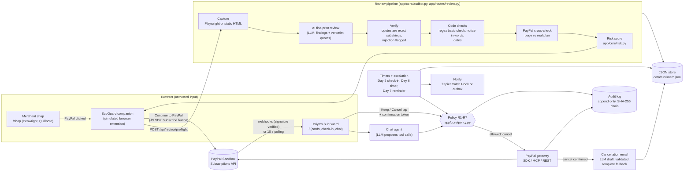
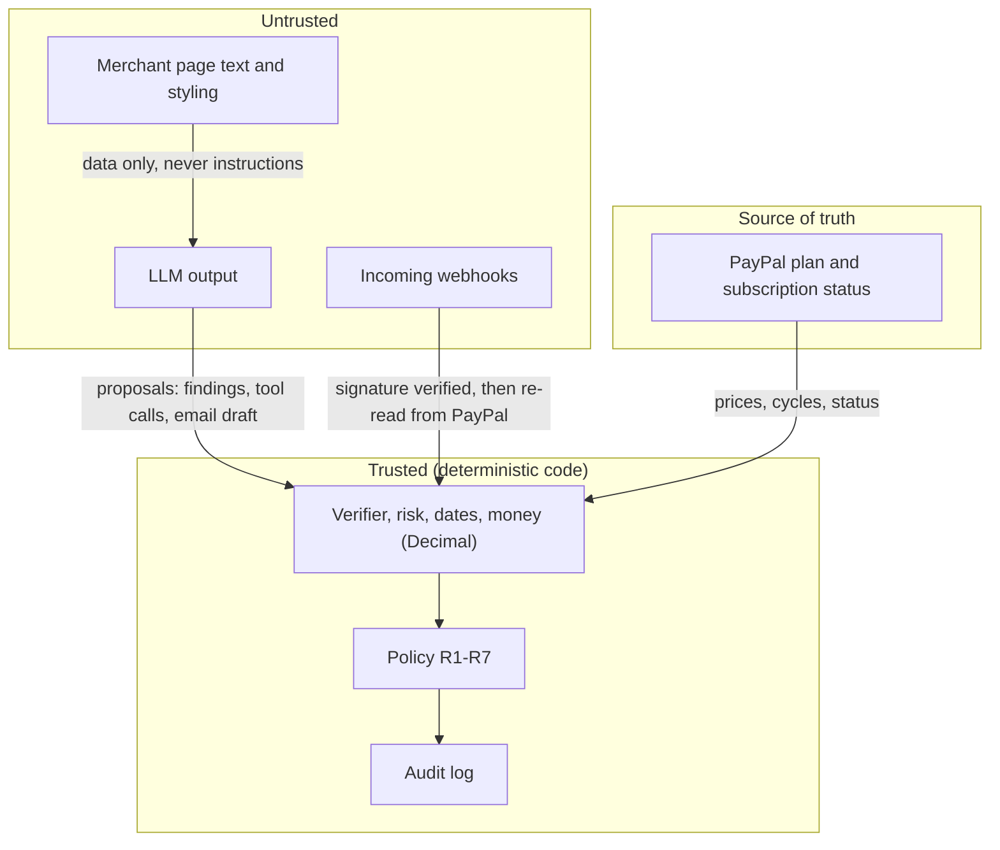

# SubGuard architecture

One FastAPI process (one Uvicorn worker), JSON files for state, and one interface per integration with a mock and a
sandbox implementation picked at startup (`APP_MODE=mock|sandbox`). The AI only proposes; deterministic code
decides and PayPal enforces.

## Flow

Code map:

| Box | Files |
|---|---|
| Shop | `shop/`, `shop/static/checkout_sandbox.js` (PayPal JS SDK button) |
| Companion, home | `app/templates/`, `app/static/`, `app/routes/home_view.py`, `app/core/verdict.py` |
| Capture | `app/integrations/capture.py` (static), `capture_live.py` (Playwright, sandbox) |
| AI | `app/llm/base.py`, `anthropic_provider.py`, `openai_provider.py`, `mock_provider.py`, `tools_schema.py` |
| Verify, code checks | `app/core/auditor.py`, `patterns.py`, `durations.py`, `data/seed/dark_patterns.json` |
| PayPal cross-check, risk | `app/core/crosscheck.py`, `app/core/risk.py` |
| Policy | `app/core/policy.py`, `app/core/actions.py` |
| Timers, escalation | `app/core/timers.py`, `escalation.py`, `alerts.py`, `layer2.py` |
| Gateway | `app/integrations/paypal_gateway.py`, `paypal_sdk.py`, `paypal_mcp.py`, `paypal_rest.py`, `paypal_mock.py` |
| Webhooks | `app/routes/webhooks.py` (verify via `paypal_rest.py`) |
| Notify | `app/integrations/notify.py` |
| Cancellation email | `app/core/notices.py`, `app/routes/notices.py` |
| Store, audit | `app/store.py`, `app/core/audit_log.py` |

## Trust boundaries

1. **Merchant page -> AI.** Page text is untrusted. It goes to the model inside `<page_text>` tags. Instructions in
   it are never followed; they are reported as `PROMPT_INJECTION_ATTEMPT` and weigh 0 in the score.
2. **AI -> code.** The model returns structured findings. Every quote must be a verbatim substring of the captured
   page or the finding is dropped. Durations in words are converted by code (`durations.py`). The model never
   computes a price, a date or a score.
3. **Code -> PayPal.** The plan's billing cycles are the source of truth for every price. Status shown to the user is
   read from PayPal, never assumed.
4. **Proposal -> action.** The chat agent and the UI can only *propose* a cancel. `policy.py` decides, with a
   single-use confirmation token (R1, R3), rate limits (R4), ownership (R5) and the essential tag (R6). The safety
   timer (R2) acts alone only when the user was told at sign-up, warned 24 sim-hours before, and didn't tap Keep.
5. **Everything -> audit log.** Every decision, allowed or blocked, is appended with its rule id. The SHA-256 chain is
   checked by `GET /api/audit-log/verify`. Secrets are masked before logging.
6. **Webhooks.** In sandbox mode each event is checked with PayPal's verify-webhook-signature API
   (`PAYPAL_WEBHOOK_ID`) and rejected (and audited) if it fails. Without a public URL the app polls PayPal instead.

## Auth

Phase 7 puts a sign-in wall in front of Priya's SubGuard (D-178..D-180). There is no sign-up: the one account is
Priya's email from `users.json` and the password in `DEMO_PASSWORD`.

- **Cookie, no server sessions.** `POST /login` checks the email (any case) and the password
  (`hmac.compare_digest`), then sets `sg_session` = `base64url(user_id|expiry).base64url(HMAC-SHA256)` keyed with
  `SESSION_SECRET`. HttpOnly, SameSite=Lax, Secure over https, `SESSION_HOURS` long. `POST /logout` clears it.
- **Access middleware** (`app/auth.py`, `AuthMiddleware`). Runs before every route and sets
  `request.state.user_id`. Public: sign-in pages, `/healthz`, static files, the shops, the companion's preflight,
  the PayPal webhook and the simulated autopay page. Everything else needs a session: signed-out HTML is redirected
  to `/login?next=...` (local paths only), signed-out `/api/*` gets 401. A `?user=` other than the session user
  gets 403.
- **R5 is still the data guard.** Routes keep their `user` parameter; the middleware only makes sure it can't name
  someone else. Ownership checks in `policy.py` and the `owner_id == user` filters are unchanged.
- **Audit.** `signed_in`, `sign_in_failed` (including the 5-per-minute-per-IP rate limit) and `signed_out` go to the
  audit log with rule id `AUTH`, the email masked, never the password.
- **Missing values.** Sandbox mode refuses to start without `DEMO_PASSWORD` and `SESSION_SECRET`. Mock mode starts
  anyway: a random per-process session secret, and "Sign-in is off" on the sign-in page if there is no password.

## Modes

| Integration | `mock` | `sandbox` |
|---|---|---|
| PayPal | JSON state machine (`APPROVAL_PENDING -> ACTIVE -> CANCELLED`) | `paypal-server-sdk`, PayPal MCP server, httpx for the gaps |
| LLM | recorded answers in `data/fixtures/` | Anthropic or OpenAI (`LLM_PROVIDER`, model from env) |
| Capture | static HTML capture | Playwright Chromium (falls back to static) |
| Notifications | `data/runtime/outbox/` | Zapier Catch Hook if set, else outbox |

`/healthz` and the top bar show the mode and each integration's state.
